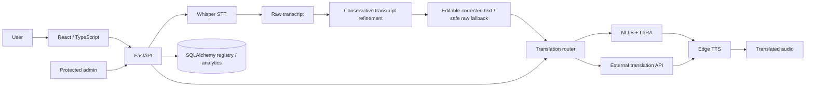
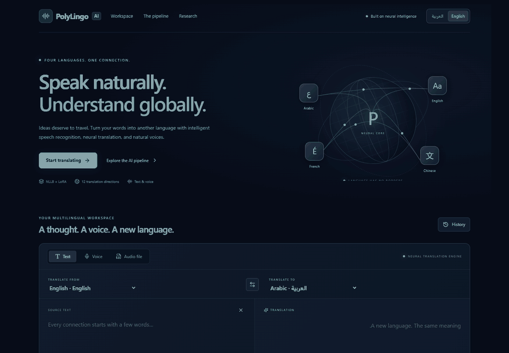
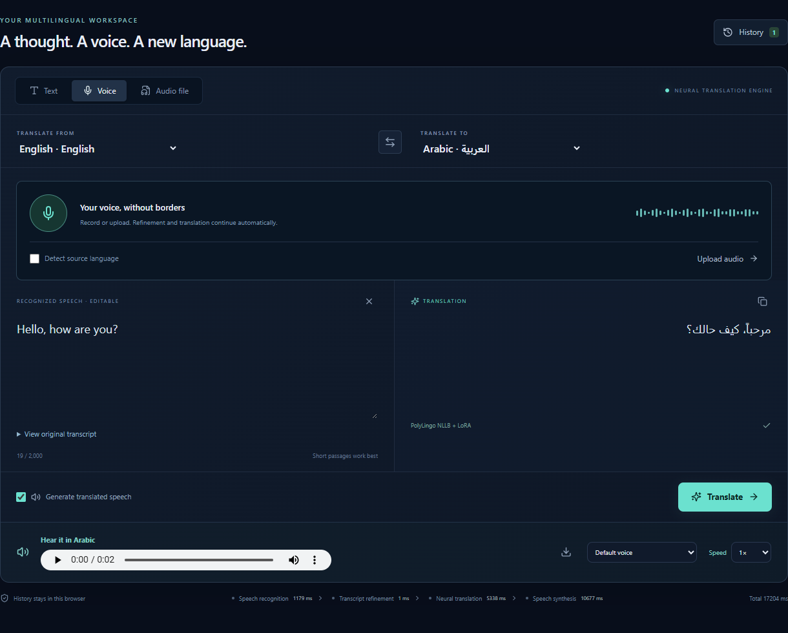
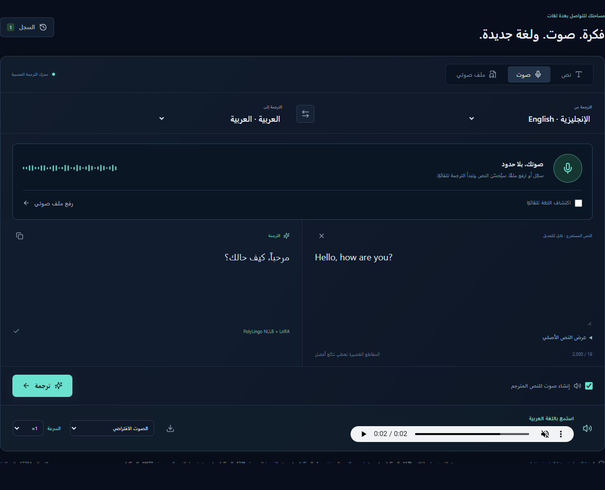

# PolyLingo AI

**Intelligent Multilingual Speech Translation Platform**

Speak naturally. Understand globally.

PolyLingo AI adds a React application and modular FastAPI service to an existing NLLB + LoRA research project. Translate text, record a microphone or upload audio, and automatically receive a conservatively refined transcript, translation, and optional speech. Arabic, English, French, and Chinese are enabled initially.

> Deployment readiness is separate from model suitability. Meta distributes NLLB under CC-BY-NC-4.0 and describes production deployment as outside its intended use. Review the [upstream model card](https://huggingface.co/facebook/nllb-200-distilled-600M) before hosting or commercial use. Translation quality varies by direction.

## Features

- Premium responsive translator with Arabic RTL, editable Whisper transcription, animated microphone levels, and staged progress.
- Arabic and English interface switcher across the translator and admin screens. Arabic is the default; your choice is saved separately from source and target translation languages.
- Fine-tuned NLLB inference with beam search, CUDA selection, CPU fallback, lazy loading, and serialized access.
- Edge neural speech, voice selection, speed, play/pause/replay, and MP3 download. Edge sends translated text to an external service.
- Browser-local translation history with copy, repeat, replay, and clear.
- Automatic interpreting after speech recognition, with preserved raw/corrected transcripts, conservative local refinement, optional API correction, streamed progress, and explicit translation of manual edits.
- Protected admin workspace: model/language/provider registration, defaults, routing/fallback, analytics, safe logs, and application settings.
- Encrypted API credentials, Argon2 passwords, revocable HttpOnly sessions, CSRF validation, bounded inputs, and safe errors.
- SQLite development storage with SQLAlchemy; PostgreSQL can be configured with a database driver.
- Docker deployment, API tests with mocked weights, and preservation checks for original research.

## Architecture



The pipeline is **audio → Whisper → raw transcript → conservative transcript refinement → NLLB + LoRA → translated text → optional TTS → audio**. Voice mode now continues automatically through one streamed request. The original transcript is preserved, edits remain available, and manually changed text is translated only on request. Text mode continues to use the existing translation provider directly. No processing progress is simulated. See [transcript correction](docs/transcript-correction.md) for administration, contracts, and limitations.

### Supported languages

| Language | Native | ISO | NLLB | Direction |
|---|---|---|---|---|
| Arabic | العربية | ar | arb_Arab | RTL |
| English | English | en | eng_Latn | LTR |
| French | Français | fr | fra_Latn | LTR |
| Chinese | 中文 | zh | zho_Hans | LTR |

Language metadata comes from the database API. New entries require valid provider mappings and compatible weights; adding metadata does not train a language.

## Research and evaluation

Primary model: `facebook/nllb-200-distilled-600M` with the existing adapter in `models/polyligo_nllb_lora/best_adapter/`. No training is performed by the application. The unchanged `helper.py` and `PolyLingo_AI.ipynb` contain the research pipeline.

LoRA trains low-rank updates instead of all base parameters. Adapter metadata confirms rank 16, alpha 32, dropout 0.05, and q/k/v/out attention projections. PEFT attaches these updates at inference.

The notebook uses aligned `nirmalendu01/opus100-en-fr-de-ar-zh` rows and OPUS-100 Arabic–English, English–French, and English–Chinese anchors. Cleaning, English-anchor holdout exclusion, balanced directed sampling, and evaluation logic remain in the research code. Configuration targets 5,000 training examples per direction, 150 evaluation examples per direction, 128-token sequences, two epochs, and learning rate 1e-4. Configured targets are not asserted as actual processed dataset counts.

| Macro metric | Baseline validation | Fine-tuned validation | Final test |
|---|---:|---:|---:|
| BLEU | 18.711 | 25.461 | 25.962 |
| chrF++ | 34.074 | 36.742 | 36.721 |

Validation BLEU improves **+6.750**. Evaluation CSVs contain 12 directions with 150 examples each (1,800 total). Supplied best validation loss: **3.0535**, best epoch: **2**; see notebook output. Direction-level results include regressions as well as improvements; inspect `results/before_after_comparison.csv` before making quality claims.

## Development setup

Requires Python 3.11+, Node 22+, available model weights, and sufficient RAM. All commands run from the repository root unless noted.

```powershell
python -m venv .venv
.venv\Scripts\Activate.ps1
python -m pip install -r requirements.txt
Copy-Item .env.example .env
  python scripts/setup_admin.py
python -m uvicorn backend.app.main:app --host 127.0.0.1 --port 8000
```

In another terminal:

```powershell
cd frontend
npm ci
npm run dev
```

Open [the translator](http://localhost:5173) and [admin](http://localhost:5173/admin). The public UI does not display administrator controls or links. API documentation: [FastAPI Swagger](http://127.0.0.1:8000/api/docs). Microphone access requires localhost or HTTPS and permission.

The Vite proxy defaults to backend port 8000 and supports `POLYLINGO_API_PROXY_TARGET` in `frontend/.env.local`. This workspace's active preview uses `http://127.0.0.1:8001`; when restarting that preview, run Uvicorn with `--port 8001`, or change the ignored override back to port 8000. Production Nginx routing is independent of this local override.

The API starts without loading weights. The first translation can be slow while weights load/download. Use short passages: this research adapter was trained with a 128-token source limit; oversized token input is rejected instead of silently truncated. Download Whisper before using microphone or uploaded-audio transcription:

```powershell
python scripts/prepare_speech_model.py --model tiny --activate
```

This prepares the multilingual Whisper tiny checkpoint for CPU use, verifies its SHA-256, and selects it as the active STT provider. It supports resumable parallel downloads and stores weights under runtime/whisper-tiny. For improved recognition quality at a higher compute/download cost, use `--model base` or `--model small`; the existing translation adapter is independent of this choice. Selectors and API values stay unchanged when the interface language changes.

Speech requests load complete local checkpoints only: missing or incomplete weights produce an actionable error and do not block text translation. The older `scripts/download_speech_model.py --model small` command remains available for preparing the standard Hugging Face cache without changing model defaults; use `WHISPER_CACHE` consistently when downloading and serving through that route. Edge TTS needs outbound network access.

If requests are busy, `/api/health` reports active requests and the model currently loading. Waiting for the model lock is bounded by `INFERENCE_QUEUE_TIMEOUT` (30 seconds by default). A full admission queue returns 429 with `Retry-After: 5`. API docs work at `/docs` and `/api/docs`; the schema is served at `/api/openapi.json` so Swagger also works through the frontend proxy.

### Environment

See [.env.example](.env.example). Credentials are never preconfigured. The admin bootstrap prompts privately for a password and generates a Fernet key. Preserve that key across restarts to keep stored provider secrets readable.

- `DATABASE_URL`: SQLite by default; use `postgresql+psycopg://...` after installing `psycopg[binary]`.
- `ADAPTER_PATH`, `HF_CACHE`: existing research adapter and base model cache.
- `ADMIN_USERNAME`, `ADMIN_PASSWORD_HASH`: admin identity and Argon2 hash.
- `ENCRYPTION_KEY`: Fernet encryption key; never publish it.
- `SECURE_COOKIES`: true for HTTPS production.
- `ALLOWED_ORIGINS`: exact trusted frontend origins.
- `ALLOWED_PROVIDER_HOSTS`: comma-separated approved HTTPS provider DNS names.
- `MAX_UPLOAD_MB`, `SESSION_HOURS`: request and session limits.

### CPU and CUDA

CPU runs are supported and use float32 for NLLB. Latency is substantially hardware-dependent and has no real-time guarantee. Use one API worker; otherwise every process loads another model.

For the RTX 4070 Laptop 8 GB, install a CUDA-enabled PyTorch wheel appropriate to the host driver using the [official PyTorch selector](https://pytorch.org/get-started/locally/). Verify `python -c "import torch; print(torch.cuda.is_available())"`. NLLB defaults to CUDA float16 when available. Whisper defaults to CPU int8. The manager keeps one heavy local model resident at a time and serializes load/inference; changing between local STT and translation evicts the previous model to bound memory. Model setup supports explicit device and precision choices.

## Administration

Run `python scripts/setup_admin.py` first, restart the API, and sign in at `/admin`. Defaults for translation/STT/TTS are selected in AI Models. Testing a translation model performs a short real inference. STT/TTS testing initializes the provider; an actual speech request is required to verify audio inference/connectivity.

Providers support a documented custom REST translation contract and OpenAI-compatible chat completion endpoint. Register an allowed host server-side, save the provider key, then attach its registry ID to an external translation model. Saved keys are encrypted and omitted from all responses. Blank key edits preserve existing credentials. Route by ISO language pair and optionally choose an explicit fallback model; fallback use is returned in the translation result.

The initial speech implementations are Whisper and Edge. The speech contracts are extension points for XTTS and external speech implementations; these additional engines are not implemented or advertised as selectable working engines.

## Testing

```powershell
python -m pytest tests -q
python scripts/verify_research.py
cd frontend
npm run build
npm test
```

Tests cover health, languages, translation, routing/fallback, authentication, CSRF, secret redaction/encryption, audio validation, model queue recovery, documentation routing, Arabic/English rendering, localized speech errors, admin authorization, and maintenance. Unit tests mock expensive model inference. Run `python scripts/smoke_speech.py` against a running local API to test real English/Arabic recognition, translation, and speech output using neutral sample phrases. See [verification](docs/verification.md) for actual execution results and remaining manual acceptance checks.

## Deployment and security

`docker compose up --build` starts a backend and Nginx frontend at port 8080. Configure a production TLS reverse proxy, exact origins, secure cookies, persistent database volume, adapter mount, and outbound provider access. See [deployment](docs/deployment.md) for CPU/GPU and PostgreSQL instructions.

Do not commit `.env`, model weights, cached datasets, or runtime databases. Keep the research artifacts locally and publish large assets separately when their licenses permit. The public API is anonymous; enforce rate limits, quotas, and abuse protection at your ingress before exposing it widely. History is browser-local and is visible to other users of the same browser profile. Uploaded audio is processed in temporary storage and removed; request text is not stored server-side. Full security guidance is in [security](docs/security.md).

## Documentation

- [Architecture](docs/architecture.md)
- [Model and training](docs/model.md)
- [Transcript refinement and automatic voice translation](docs/transcript-correction.md)
- [Interpreter improvement implementation report](docs/interpreter-improvements.md)
- [API contracts](docs/api.md)
- [Deployment](docs/deployment.md)
- [Security](docs/security.md)
- [Audit and implementation plan](docs/implementation-plan.md)
- [Contributing](CONTRIBUTING.md)
- [Changelog](CHANGELOG.md)

## Demo and screenshots · العرض والصور

تجربة فعلية للتسجيل والترجمة الصوتية، مع واجهة عربية وإنجليزية. استُخدم صوت اصطناعي تجريبي محايد لحماية الخصوصية؛ التعرف على الكلام والترجمة وتوليد الصوت نُفذت بالخدمات الفعلية.

Real application capture: record a neutral synthetic greeting, recognize it with Whisper, translate with NLLB + LoRA, play the translated speech, inspect local history, and switch to Arabic. Processing time is preserved. The GIF is silent; [download the MP4 with audio](docs/media/interpreter-demo.mp4).



| English workspace | الواجهة العربية |
| --- | --- |
|  |  |

[Arabic homepage](docs/media/home-ar.png) · [English homepage](docs/media/home-en.png) · [Mobile voice workspace](docs/media/mobile-voice-ar.png) · [Protected admin sign-in](docs/media/admin-signin-ar.png)

See [capture details and reproducible checks](docs/demo.md). The admin image shows the sign-in screen; no credentials or private dashboard data appear.

## Future work

Implement XTTS-v2 and additional speech providers behind the existing contracts, durable background job queues and streaming, authenticated cross-device histories with retention controls, multi-process GPU scheduling, database migrations, and expanded per-direction quality evaluation.

## License and acknowledgements

No repository-wide license has been assigned: the owner must choose terms for original application and research code. Third-party model and dataset licenses remain applicable. See [LICENSE](LICENSE). Thanks to Meta NLLB, Hugging Face Transformers/PEFT, OPUS contributors, Whisper/faster-whisper, Edge TTS contributors, FastAPI, SQLAlchemy, React, Vite, Tailwind CSS, and Lucide.

