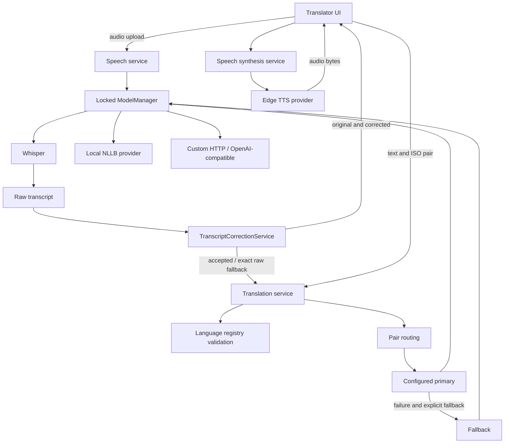

# Architecture

The application is additive: notebook, helper, adapters, datasets, evaluation files, and chart are preserved. A SHA-256 manifest records original research artifacts.

## Components

React/TypeScript uses a Vite dev proxy and Nginx production proxy. Tailwind is integrated; the visual system is defined in CSS. The public translator and admin page are separate React components. Language selectors use API metadata. Arabic text direction follows the configured language.

FastAPI separates HTTP routing, validated schemas, SQLAlchemy persistence, provider implementations, and orchestration. Structured registry records store model, provider, language, routing, and setting configurations. Event rows contain only language direction, timing, mode, provider, status, and timestamp. Operational logs are fixed safe messages. Admin sessions are hashed server-side tokens with expiry and CSRF tokens.

## Model lifecycle

The manager is process-local and lazy. Its reentrant lock serializes local loading and inference to protect tokenizer language mutation and GPU memory. One heavy local instance is kept resident. Switching heavy models drops references, collects Python objects, and releases unused CUDA allocations. Inference uses `torch.inference_mode`. Whisper defaults to CPU, NLLB to available CUDA/CPU. Use a single Uvicorn worker; multi-process production scheduling needs a dedicated model worker service.

The research helper's loading and generation settings are adapted, rather than importing the helper's training dependencies into the service. The model uses the original tokenizer/adapter and explicit NLLB BOS target codes. Input above 128 tokens is rejected without truncation.

## Provider contracts and routing

TranslationProvider, SpeechToTextProvider, and TextToSpeechProvider are independent interfaces. Implemented providers are local NLLB/PEFT, custom REST translation, OpenAI-compatible translation, faster-whisper, and Edge TTS. Future XTTS/external speech engines require a concrete adapter and manager registration.

A matching enabled pair rule overrides the default translation model. Only a configured fallback is tried, once, after provider failure. Validation errors do not trigger fallback. Without a pair rule, the enabled default model is used. Provider priority is stored as metadata; it does not cause implicit failover.

## Admin and database

All operational admin APIs depend on session authorization; all admin mutations additionally require CSRF. Public endpoints disclose only safe model summaries. Adding/changing a default updates other records of the same model type. Model/provider changes invalidate the resident model. Languages and routing are read per request.

SQLAlchemy supports SQLite and PostgreSQL through DATABASE_URL. Schema creation supports initial deployment; an explicit migration system is required before evolving a deployed database. Analytics show a bounded latest 10,000-event window, identified in the UI.

## Progress and history

Voice input uses one multipart POST with newline-delimited progress events for ASR, transcript refinement, translation and optional synthesis. A reducer and request IDs protect state transitions, while AbortController supersedes cancelled recordings. Raw/corrected text is sent before translation begins; text can be edited without triggering model calls per keystroke. Native controls play Blob audio URLs. History stores both transcripts and processing time locally, capped at 40 entries. Admission capacity is held until the entire stream finishes, not merely until response headers are sent.

TranscriptCorrectionProvider has rule-based, hybrid, and API implementations. The default Hybrid uses only CPU-safe normalization and context grammar unless an optional provider is selected. A separate service validates candidates, protects sensitive substrings and lexical content, and returns exact raw input on uncertainty or provider failure. See [the correction design](transcript-correction.md); NLLB remains a translation provider exclusively.

## Operational limits

A four-request admission limit prevents an unbounded local inference queue. Full capacity returns 429 with Retry-After. Waiting to acquire the shared model lock times out after INFERENCE_QUEUE_TIMEOUT seconds (default 30), returning a safe 503 and releasing request capacity. Health reports active requests, the loading model, and load duration. This is process-local, not a distributed quota. Configure an ingress limit and rate controls. Audio is streamed to a bounded temporary file, decoded under a duration sample budget, and removed on completion/failure. Whisper checkpoints must be downloaded with scripts/download_speech_model.py before serving speech; cache completeness is checked before evicting an existing translation model, and requests never download Whisper weights. Edge TTS has a 45-second timeout; external translation providers use validated configured timeouts and disallow redirects.

