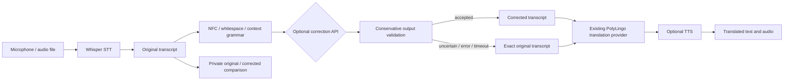

# Transcript refinement and automatic interpreting

The existing translation provider remains the fine-tuned NLLB + LoRA adapter. Speech recognition and correction have separate responsibilities and never use NLLB as a spell checker.



## Active defaults

- `AUTO_TRANSLATE_VOICE=true`
- `TRANSCRIPT_CORRECTION_ENABLED=true`
- `TRANSCRIPT_CORRECTION_PROVIDER=hybrid`
- `CORRECTION_CONFIDENCE_THRESHOLD=0.95`

Environment values seed defaults; saved Admin settings override them. Existing databases receive new defaults through the settings reader, without replacing old records or migrating research assets.

With no correction API selected, Hybrid runs lightweight deterministic normalization and grammar rules on CPU. No extra model, GPU allocation, paid service, or dependency is needed. Rule registries are per-language and can be extended. The Arabic greeting/well-being grammar uses pronouns, noun suffix agreement, and local context; it does not replace an entire sample sentence. English/French rules cover narrow grammatical confusions. Chinese normalization preserves characters; optional providers may add punctuation subject to the same guards.

This is deliberately not a general-purpose spell checker. Unknown corrupt words and domain terminology are retained. Whisper tiny can produce errors outside these rules; selecting a larger ASR model or configuring an advanced provider may help, with no quality guarantee.

## Acceptance and fallback

The service preserves raw ASR text exactly. Candidates are checked for same-language script, length, protected substrings, case-sensitive name tokens, edit size, and lexical scope. Numbers, dates, URLs, emails, identifiers, technical tokens, quoted text, and code are protected. Uncertain substantive word substitutions from an advanced provider are rejected. There is no generic named-entity recognizer; unknown lower-case names are protected by rejecting unknown lexical changes rather than guessing their spelling.

The threshold is a **heuristic safety score**, not calibrated statistical confidence. API `correction_confidence` remains null when reliable confidence is unavailable; `correction_safety_score` reports the guard score. An external provider's self-reported confidence is not trusted.

On rejection, timeout, unavailable configuration, or provider exception, return the exact original raw transcript with `correction_status=fallback` and still translate it. This includes discarding preliminary normalization when the advanced stage fails. Disabled correction/per-language settings return `correction_status=disabled`.

Changed spans contain code-point offsets into the original string, plus replacement text. Clients using UTF-16 must convert offsets before slicing. The current UI displays original/corrected text without slicing spans.

## Admin setup

Open **Admin → Transcript Correction**.

| Control | Saved setting |
|---|---|
| Correction enabled | transcript_correction_enabled |
| Automatic voice translation | auto_translate_voice |
| Local rules / Hybrid / LLM | transcript_correction_provider |
| Enabled languages | correction_languages |
| Acceptance threshold | correction_confidence_threshold (0.8–1) |
| External integration | correction_api_provider_id |
| Model identifier | correction_model_id |
| Timeout | correction_timeout (up to 30 seconds) |
| Fallback | correction_fallback=raw (always enforced) |

To use an optional API, first register it under Providers, allow its HTTPS DNS hostname in ALLOWED_PROVIDER_HOSTS, and save its encrypted credential. Select that provider in Transcript Correction. Hybrid without an API uses local rules; LLM requires an enabled API provider. Provider and language references are validated on saving. Provider configuration changes are read for every request.

Supported external adapters:

- OpenAI-compatible: POST `{base_url}/chat/completions`, low temperature, strict transcript-only system instructions, source language explicit, transcript/context supplied as untrusted data. The response must contain the corrected transcript in choices[0].message.content.
- Custom REST: POST `{base_url}/correct` with text, language, context, optional asr_confidence, and model. Return `{"corrected_text":"..."}`.
- A local LLM served through one of those API contracts can be selected the same way, behind trusted HTTPS. There is no newly downloaded native local LLM in this release. For a native local implementation, implement TranscriptCorrectionProvider and register it in the correction service; respect the model manager's memory budget.

Keys stay server-side, redirects and environment proxies are disabled, hosts are revalidated at use time, response size is bounded, and the entire provider call has a timeout. No correction transcripts, prompts, outputs, or changed spans are stored in operational logs or analytics.

## One-request API and real progress

POST `/api/speech/translate` accepts multipart fields:

- file: supported audio
- source: optional ISO; omit for ASR detection
- target: required ISO
- generate_voice: boolean, default false for older clients
- voice: optional provider voice ID
- speed: -50..50

By default it returns structured JSON. The frontend uses `?stream=true` and receives newline-delimited JSON with actual processing events:

```json
{"event":"stage","stage":"transcribing"}
{"event":"raw_transcript","data":{"raw_transcript":"...","detected_language":"ar","stt_ms":820}}
{"event":"stage","stage":"correcting"}
{"event":"transcript","data":{"raw_transcript":"...","corrected_transcript":"...","detected_language":"ar"}}
{"event":"stage","stage":"translating"}
{"event":"translation","data":{"translated_text":"..."}}
{"event":"stage","stage":"synthesizing"}
{"event":"result","data":{"translation_status":"complete","tts_status":"complete"}}
```

The shown data objects are abbreviated. raw_transcript is emitted immediately after ASR; transcript contains the accepted corrected text. Every transcript/translation/result event contains the structured speech result schema; see OpenAPI. Stages are emitted only when that work is performed. No timers manufacture progress. ASR failures become an error event in streaming mode, since headers are already sent; JSON mode keeps normal validation/error status codes.

Results include raw_transcript, corrected_transcript, correction_applied/status/provider/safety_score, changed_spans, detected_language, translated_text, translation_status, provider, tts_status, audio_url, safe errors, and timings (asr_ms, correction_ms, translation_ms, tts_ms, total_ms). Compatibility fields text/language/stt_ms/translation_ms remain. text now aliases corrected_transcript. Timing covers server processing, including model loading/wait, but excludes network upload time.

Audio is returned as an inline audio/mpeg data URL in the response, without a public audio endpoint or persisted server recording. React converts it to a Blob URL for playback/download, and revokes old URLs. Browser history stores text and timings only, never these audio payloads.

Detected ASR language drives both correction and translation, not stale source selection. Empty ASR output never calls translation. Same-language requests return translation_status=same_language without model translation. With automatic voice translation disabled, the pipeline returns refined text with translation_status=manual.

Translation errors preserve both transcripts with translation_status=error. TTS errors preserve translated text with tts_status=error. Streaming sends text before synthesis so it remains visible if voice generation fails.

## Frontend workflow

The state machine covers uploading, transcribing, correcting, translating, synthesizing, complete, and error; microphone recording is tracked by the existing recorder. One recording/upload triggers one streamed request. Request IDs and AbortController suppress stale results, and a new recording supersedes an old request. Cancel stops waiting in the UI; already running native model work may finish before server resources are released.

The bottom indicator has four stages. A subtle refinement badge and expandable original/corrected comparison appear after correction. Transcripts stay editable during automatic translation. Keystrokes only update the local input; they never invoke models. The previous automatic translation remains visible until the user chooses **Translate edited text**.

The admission middleware holds capacity until a streamed response ends, including cancellation. Model calls are offloaded without abandoning worker threads while database/temp-file resources are in use. Inference is still serialized by the existing model manager.

History is private to the browser profile and obeys history_enabled. Speech entries include raw/corrected text, detected source, target, translation/correction providers, total processing time, translation, and status.

## Validation

Automated coverage includes clean/uncertain input, narrow multilingual context rules, the supplied corrupted Arabic example and variants, exact fallback on provider failure/timeout, name/number/code/URL preservation, wrong-language output, Chinese punctuation, auto-detection, empty and same-language input, automatic translation, structured raw/corrected results, retained text on TTS failure, streamed stage order/capacity recovery, API host/key/timeout behavior, and frontend cancellation/state transitions.

Real streamed smoke tests through the frontend proxy exercised Arabic → English, English → Arabic, French → English, and Chinese → Arabic with installed Whisper, the original NLLB adapter, and Edge TTS. See verification.md for observed outputs and limitations.

